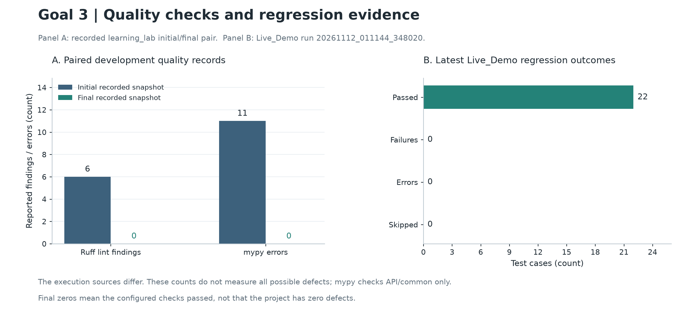

# 43030 ML Workflow Lab

A small, runnable Python project for practising Git workflow, software quality and the operation of a machine-learning API. It trains a handwritten-digits classifier, tests its input and authentication rules, and checks how the service responds to a damaged model file.

## What is included

| Component | Purpose |
| --- | --- |
| `learning_service/train.py` | Train a StandardScaler and LogisticRegression Pipeline and record metrics, hashes and an MLflow run. |
| `learning_service/api.py` | Serve predictions with an API-key check, a 64-pixel input contract, request-size limits and model-integrity checks. |
| `tests/test_api.py` | Check accepted and rejected requests, training-only preprocessing, readiness and recovery. |
| `scripts/quality.py` | Run Ruff lint, formatting and the configured mypy checks. |
| `learning_service/recovery.py` | Corrupt a temporary model copy, check refusal, then restore the trusted copy. |
| `learning_service/observations.py` | Measure sequential HTTP requests and a controlled pixel-intensity change. |
| `run_demo.py` | Execute the complete demonstration and save fresh results. |
| `visualisation/` | Redraw the Goal 3 quality chart from historical records. |

These components support Goals 2, 3 and 4 of the learning portfolio. They share one model service.



The chart redraws historical quality records. `VALIDATION.json` records the separate fresh-source verification of this upload package.

## Run from a fresh clone

Use Python 3.12 and Git. From the repository root:

```sh
python3.12 -m venv .venv
.venv/bin/python -m pip install -r requirements.lock
.venv/bin/python run_demo.py
```

On Windows, replace `.venv/bin/python` with `.venv\Scripts\python.exe`.
If using a downloaded ZIP instead of `git clone`, initialise and commit a Git snapshot before training; the training record uses the current commit identifier.

The demonstration runs quality checks, training, tests, seven HTTP cases, a recovery drill, a 200-request benchmark, a controlled input change and a dependency-advisory lookup. Read the newly generated `evidence/LIVE_RUN_SUMMARY.md` for that execution. Dependency installation and the advisory lookup require network access; lookup failures are reported as failures.

## Run the quality checks and tests separately

```sh
.venv/bin/python scripts/quality.py final
.venv/bin/python -m learning_service.train
.venv/bin/python -m pytest -v
```

Training must precede the API tests because it creates the model and split records. Ruff checks the application, tests and scripts. Mypy checks `api.py` and `common.py`; its result does not cover every module or dependency.

## Try the API

After training:

```sh
.venv/bin/python serve_demo.py
```

The terminal prints the loopback URL and a temporary demonstration key. Open `/docs`, authorise with that key, and send the generated example request to `/predict`. `/health` reports process liveness; `/ready` checks whether the model is ready. Expected refusal responses include 401, 413, 422 and 503.

VS Code tasks and launch settings are included. After creating `.venv`, open the repository folder and run **Run complete learning demo** or **Start interactive prediction API**.

## Generated data and limits

Models, virtual environments, execution logs, MLflow databases and run snapshots are generated when the project runs and are excluded from Git. No production API key is included; tests use an explicit non-secret fixture key.

The dataset is the public 8 by 8 digits subset provided by scikit-learn. The experiment is a new stratified split within that subset, not a medical model or a writer-independent evaluation. Latency measures one loopback worker with sequential repeated requests. The controlled pixel change is a stress test, not a validated natural-drift detector. Model hashing depends on a trusted manifest.

GitHub Actions and Docker configuration are included. A configuration alone is not evidence of an executed build: check the actual Actions run before claiming hosted CI success. The plotting kit redraws saved results and does not rerun the application tests.

## Sources and preparation

This learning implementation was prepared with Codex assistance. The original development records remain separate from new runs of this published source.

- Alpaydin, E., & Kaynak, C. (1998). *Optical recognition of handwritten digits* [Data set]. UCI Machine Learning Repository. https://doi.org/10.24432/C50P49
- scikit-learn: https://scikit-learn.org/stable/common_pitfalls.html
- FastAPI: https://fastapi.tiangolo.com/reference/security/
- MLflow Tracking: https://mlflow.org/docs/latest/ml/tracking/
- Ruff: https://docs.astral.sh/ruff/
- mypy: https://mypy.readthedocs.io/en/stable/
- pip-audit: https://github.com/pypa/pip-audit
