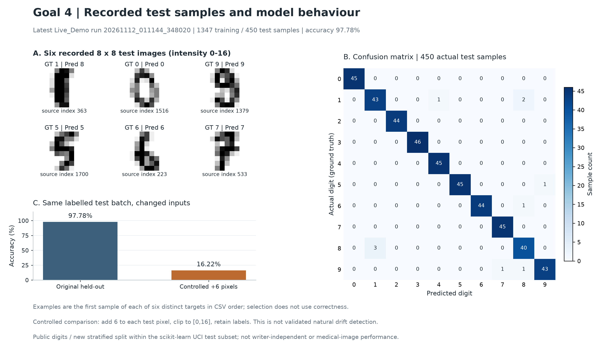

# Goal 4 Model Tracking Monitoring and Recovery

This activity follows a small digits model from training to prediction, observation and recovery. It uses the same application as Goals 2 and 3, with the focus on identifying the model being served and checking its behaviour when inputs or model files change.

## Implementation

| Part of Goal 4 | Code | What it records or checks |
| --- | --- | --- |
| Training and experiment tracking | [train.py](../learning_service/train.py) | Training-only preprocessing, held-out evaluation, MLflow parameters and metrics, model hash, split and source identity. |
| Service readiness | [api.py](../learning_service/api.py) | Separate liveness and readiness checks, with integrity checks before prediction. |
| Controlled recovery | [recovery.py](../learning_service/recovery.py) | Change a temporary model copy, refuse predictions, then restore a trusted copy. |
| Performance and input sensitivity | [observations.py](../learning_service/observations.py) | Sequential HTTP durations and a deliberately constructed pixel-intensity change. |
| Automated regressions | [test_api.py](../tests/test_api.py) | API behaviour, model identity, readiness, corruption and restoration. |
| Data visualisation | [plotting kit](visualisation/) | Recreate the recorded model and timing charts from their input data. |

## Run a new experiment

Use Git and Python 3.12. From the repository root:

```sh
python3.12 -m venv .venv
.venv/bin/python -m pip install -r requirements.lock
.venv/bin/python run_demo.py
```

The complete demonstration creates a new model and MLflow run, executes the tests and HTTP cases, performs the recovery drill, measures 200 sequential requests after 10 warmups, and checks known dependency advisories. It prints the new run identifier and generates a fresh results summary. Installation and the advisory lookup require network access.

To run the Goal 4 components separately, use a clean shell without a `LAB_ARTIFACT_DIR` override and run these commands from the repository root:

```sh
.venv/bin/python -m learning_service.train
.venv/bin/python -m pytest -v
.venv/bin/python -m learning_service.recovery
.venv/bin/python -m learning_service.observations
```

The recovery and observation scripts start their own loopback service and temporary demonstration key. Training must run first. On Windows, replace `.venv/bin/python` with `.venv\Scripts\python.exe`.

## Recorded example



The plotting kit reproduces demonstration `20261112_011144_348020`, with MLflow run `1cfe6269b9ad4da0be83b4567d7be9ee`. Its 450 held-out examples include 440 correct predictions, giving 97.78% accuracy. Adding six intensity units to each test pixel and clipping to [0,16] reduced accuracy to 16.22%.

The recorded recovery drill kept `/health` at 200 while `/ready` and `/predict` changed from 200 to 503 after corruption, then returned to 200 after restoration. These are observed response categories, not numerical security scores.

The fixed plotting data retain the original measurements. A new execution produces its own run identifiers and timings; it should be reported separately. The plotting script validates model identity, the exported CSV checksum and agreement between the summary and individual records before drawing.

## Scope

MLflow uses SQLite and files for this exercise. The benchmark uses one loopback worker and sequential repeated requests. The controlled input change is a stress test, not a validated detector of natural or concept drift. The exercise provides no cloud-capacity, medical-performance or production-reliability claim.

The repository's GitHub Actions workflow checks code quality, trains the model and runs pytest. The command-line recovery drill, HTTP benchmark and dependency audit are separate steps in the full demonstration.

The original records and new executions remain distinct.

## Data and learning sources

- Alpaydin, E., & Kaynak, C. (1998). *Optical recognition of handwritten digits* [Data set]. UCI Machine Learning Repository. https://doi.org/10.24432/C50P49
- [MLflow Tracking documentation](https://mlflow.org/docs/latest/ml/tracking/)
- [scikit-learn common pitfalls](https://scikit-learn.org/stable/common_pitfalls.html)
